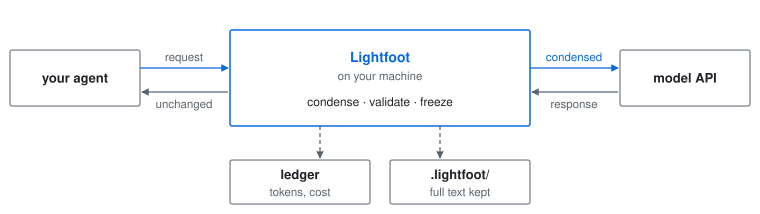
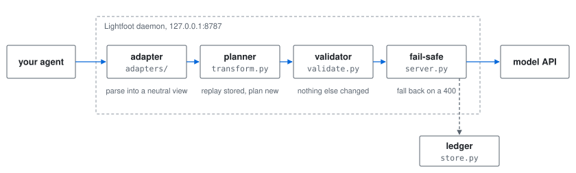
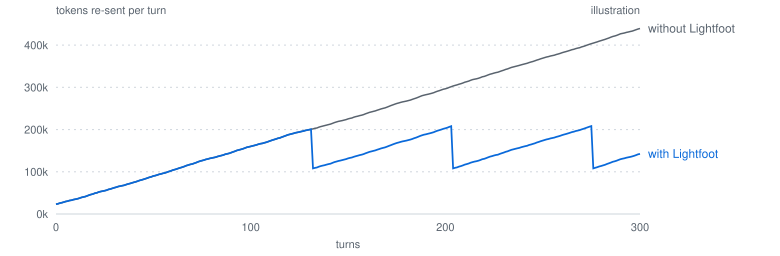
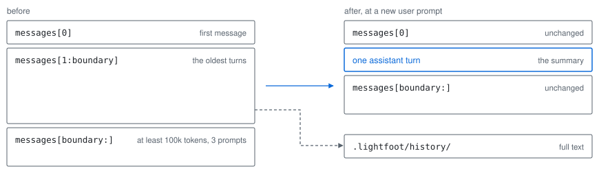
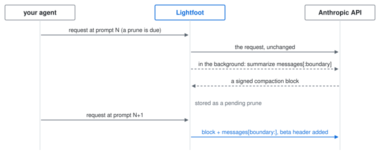
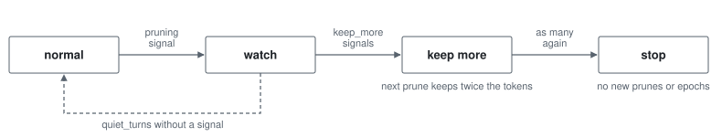
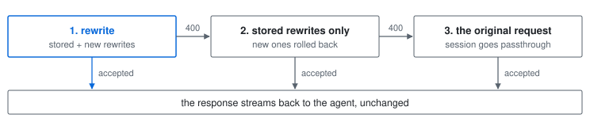
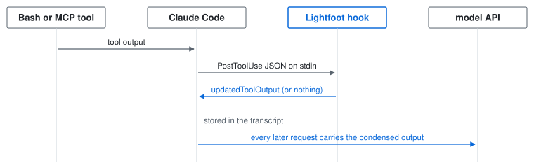

# Architecture

Exactly what Lightfoot does to a request, and why. For contributors, and for anyone who wants to check. The examples use Claude Code, the agent with the deepest support; every other agent goes through the same pipeline with its own [adapter](#adapters-and-profiles).

**Contents:** [Overview](#overview) · [The frozen transcript](#the-one-rule-a-frozen-transcript) · [Rules](#rules) · [Old-turn pruning](#old-turn-pruning) · [Economics](#economics) · [Thinking blocks](#reasoning-prefix-check-thinking-blocks) · [Quality guards](#quality-guards) · [Validation and fail-safe](#validation-and-fail-safe) · [Adapters](#adapters-and-profiles) · [Hook mode](#hook-mode-no-proxy) · [Obsidian handoff](#obsidian-handoff) · [Reporting](#reporting-surfaces) · [Storage](#storage) · [Performance](#performance) · [Security](#security-model)

---

## Overview



The big picture: Lightfoot sits between the agent and the model API on your machine, and only ever changes the request. Inside the daemon, a request passes four stages:



**Launches.** `lightfoot claude` starts the daemon if needed, registers a *launch* (project folder, mode, detected integrations, upstream URL), and runs Claude Code with `ANTHROPIC_BASE_URL=http://127.0.0.1:8787/l/<launch>`. The launch id in the path tells the daemon which project a request belongs to. Integrations are detected once per launch.

**Why `--settings`.** Claude Code applies `env` from its settings files over the process environment, so an `ANTHROPIC_BASE_URL` in `~/.claude/settings.json` (a company gateway, or `lightfoot integrate`) would send the run past its launch. Lightfoot therefore also passes the base URL in a settings file through `claude --settings`, which takes precedence. A gateway found in the settings files or the environment becomes the launch's upstream, so requests still reach it.

**What is rewritten.** Only `POST …/v1/messages` (Anthropic), `…/responses` and `…/chat/completions` (OpenAI formats, experimental), and `…/models/<model>:generateContent` or `:streamGenerateContent` (Gemini, experimental). Every other request, and every response, streams through byte for byte.

---

## The one rule: a frozen transcript

A coding agent re-sends the whole conversation on every turn, and the API caches it by prefix. Two consequences shape everything:

1. **Changing anything the model has already seen is a history edit.** It costs a cache rewrite of everything after it. On current models (Opus 5.5, Fable 5.1, Sonnet 5.5, Haiku 5.5) it also invalidates the thinking blocks after it: accounts created on or after 2026-08-31 get a 400 error.
2. **So every rewrite is made once, then frozen.** It is stored under the tool call id (or, for a prune, the session) and replayed byte-identically on every later request. Later thinking blocks were produced against exactly that text, and the cache keeps hitting.

Rewrites therefore happen at only two moments:

| Moment | Applies to | Cost |
| --- | --- | --- |
| **Ingest** | Tool output the model hasn't seen yet (after its last turn) | Free: nothing depends on it yet |
| **Epochs and prunes** | Older content, in one batch | A cache rewrite, so only when it [pays for itself](#economics) and the [thinking check](#reasoning-prefix-check-thinking-blocks) allows it |

---

## Rules

| Rule | Moment | What it does | Module |
| --- | --- | --- | --- |
| `json` | ingest | Pretty-printed JSON loses only the whitespace between tokens | `text.minify_json` |
| `json_trim` | ingest | One line of JSON: each long multi-line string inside is trimmed like `spill`; the rest is re-encoded byte for byte | `ingest.trim_json_strings` |
| `noise` | ingest | Strip ANSI and terminal redraws; collapse progress bars and repeated lines | `ingest.py`, `text.py` |
| `spill` | ingest | Output over ~4k tokens keeps head, tail and every error line; full text to `.lightfoot/spill/` | `ingest.py` |
| `images` | epoch | All but the newest `images_keep` (3) image results become a note; each image is saved to `.lightfoot/images/` first | `transform.py`, `images.py` |
| `stale_reads` | epoch | An older read of a file read again later, over the same lines, becomes a stub | `transform.epoch_candidates` |
| `searches` | epoch | Identical repeated searches; old content searches whose hits were opened since | `transform.epoch_candidates` |
| `old_results` | epoch | Old, large output nothing later refers to: head, tail, errors and a spill file | `transform.epoch_candidates` |
| `prune` | new user prompt | The oldest turns become a deterministic summary; full text to `.lightfoot/history/` | `prune.py` |

On real sessions almost all of the saving comes from `prune`. A long session's context is mostly the growing conversation and Claude's own thinking, because Claude Code already trims large tool outputs itself.

**Rule details**

- **`json`** runs first, and only when it saves at least `json_min_saving_tokens` (50) and the result still fits under the spill threshold; larger JSON goes to `spill`, whose head and tail are more useful. Nothing is re-serialized: a regex removes whitespace outside strings, and the result must parse to the same value, checked in `minify_json` and again in the validator.
- **One-line JSON** (Cline's tool results, compact MCP output) is never trimmed by `spill` or `old_results`, which would keep only the start of the line. `json_trim` decodes it, condenses each long string as `spill` would, and re-encodes it, but only if the original encoding (`JSON.stringify` or Python's `json.dumps`) reproduces exactly. The validator checks that only strings changed, each got shorter, and every error line survived. On 30 days of Claude Code history it never fired.
- **`images`** measures each image at its real cost, about width × height / 750 tokens from the image header, not its base64 length (about 40× more). If any image in a result can't be saved, the result stays whole.

---

## Old-turn pruning

Without pruning, every turn re-sends a conversation that only grows. With it, the re-sent context stays between about 100k and 200k tokens for as long as the session runs (an illustration, not a measurement).



When the conversation (the prompt minus the session's *floor*: system prompt, tools, first message) passes `trigger_tokens` (200k) and the newest message is a user prompt, the planner:

1. **Picks a boundary:** the earliest prompt that keeps at least `keep_tokens` (100k) and `min_kept_prompts` (3) prompts after it.
2. **Builds an extractive summary** of `messages[1:boundary]`, with no model call: the user's requests verbatim, Claude's closing replies, the todo list, files read and edited with the names the edits defined, commands and the paths they used, searches, subagent reports and errors. Low-priority sections shrink first to stay under `max_summary_tokens` (8,000).
3. **Writes the full text** to `.lightfoot/history/<session>-<boundary>.md` and names that path in the summary. Images in pruned turns are saved too.
4. **Replaces** `messages[1:boundary]` with one assistant turn holding the summary.



A **fingerprint** of `messages[:boundary]` (roles, ids, the shape of the text) is stored with the prune. Later requests replay the summary only while it matches; after a rewind or client-side compaction it doesn't, and the prune isn't applied.

### Options

| Setting | Default | Effect | Measured on the maintainer's 30 days |
| --- | --- | --- | --- |
| `prune.cold_trigger_tokens` | 150,000 | After an idle gap the cache is cold, so the rewrite is free: prune from this size | saving 28.5% -> 29.2%, coverage unchanged |
| `prune.cold_keep_tokens` | 0 (off) | Keep less recent conversation on a cold cache | opt-in: keeps less verbatim history |
| `prune.mid_loop` | off | Also prune when the request ends with completed tool results, never on enforcing accounts | +6 prunes, 27.4% -> 27.7%; misses 11.2% -> 11.8% |
| `prune.early_trigger_tokens` | 0 (off) | Lower the trigger for later prunes once a summary held up (no pruning signal), or from the start with model summaries | see below |
| `prune.summarizer` | `"extractive"` | `"model"`: the API writes the summary ([below](#model-written-summaries)) | about $9.72 extra, 1% of the baseline |

`early_trigger_tokens`, assuming every summary holds up: off 27.5% (misses 11.2%), 150k 26.9% (12.2%), 120k 28.3% (12.8%), 100k 28.5% (13.0%). At 150k the extra prunes cost more than they save, so it stays opt-in until the paired benchmark shows quality holds.

### Summary coverage

`estimate.SummaryCoverage` measures how often a later turn refers to something the summary left out, comparing plain text (message text, tool-input values, tool-result text). On the maintainer's 30 days the miss rate is **11.2%**:

| Missed reference came from | Share of misses |
| --- | --- |
| Code Claude wrote (`Write.content`) | 38% |
| Shell commands | 33% |
| Tool results | 16% |
| Everything else | 13% |

Most misses from written code are usages (`self.store.restore_rewrites`) that live in the file on disk. Adding the names each edit defines and the paths each command used took the rate from 11.7% to 11.2% at the same saving. More than half the prunes fill the 8,000-token budget; at 12,000 the rate drops to 10.6% and the saving to 27.3%. Getting under 8% would take model-written summaries.

### Model-written summaries

With `prune.summarizer = "model"` (opt-in, live mode only), the API writes the summary through on-demand compaction (beta `compact-2026-09-04`):



| Step | Detail |
| --- | --- |
| The request | Same model, `system`, `tools` and thinking settings, without `context_management` or `stream`. A cache marker on the last summarized message makes it read the cached prefix: 60 uncached input tokens in the live test, against 19,741 without |
| Auth | The triggering request's own headers, in memory only, and only with an API key or gateway token. Never with a Pro or Max login (the `oauth-…` beta or an `sk-ant-oat` token): subscription credentials are for Claude Code's own requests |
| The swap | At the next user prompt, never mid-task. The block replaces `messages[:boundary]`, first message included, as the API requires. Frozen and replayed like every prune |
| Thinking | The kept turns keep their thinking on enforcing accounts, so no `drop_block`; checked live with the check set to `error` |
| The cut | Only where the first kept message differs in role from the last summarized one; otherwise the API would merge them |
| Failure | A refusal, error or unsupported model marks the session; its prunes use the extractive summary |
| Cost | Its own ledger row (`attempt = compaction`); `lightfoot estimate` prices it |

---

## Economics

A history edit costs a one-time cache rewrite and saves on every later turn. With old region `S`, its new size `S′`, tail `T`, and the model's cache write and read multipliers `w` and `r`:

```text
N* = (w·(S′+T) − r·(S+T)) / (r·(S−S′))
```

An epoch or prune runs only if **the cache is already cold** (the last request is older than the cache lifetime, so the rewrite is free), or **the session has run more than `safety_factor × N*` turns**, as an estimate of how long it will continue.

With a warm cache, epochs are evaluated only every `warm_check_every` (5) turns, and not at all within `epochs.prune_near` (0.8) of the prune trigger, since a prune will soon replace those turns. Multipliers are per model (`pricing.py`): cache reads cost 0.05× on Opus 5.5, 0.025× on Fable 5.1 and 0.1× elsewhere; writes 1.25× (short TTL) and 2× or 2.5× (long TTL).

### Cache lifetime

`lightfoot estimate --cache` (`cachesim.py`) replays each conversation's idle gaps under four policies. On the maintainer's 30 days (8,259 calls; the simulated 1-hour policy came within 0.1% of the recorded cost):

| Policy | Against the 1-hour cache |
| --- | --- |
| 5-minute | +23.5%: 196 rebuilds |
| 5-minute with keep-alive | −1.2%: 1,236 pings cost $95 |
| 1-hour with keep-alive | −2.4%: 68 pings remove 9 of 26 rebuilds |

Keep-alive saves little (each ping reads the whole prompt) and would be Lightfoot's own requests, so Lightfoot doesn't send them. The lifetime matters more: with an API key Claude Code defaults to the 5-minute cache, which cost 18.8% more here. `cache.ttl = "1h"` makes `lightfoot claude` set `CLAUDE_CODE_PROMPT_CACHE_TTL` (Claude Code 2.1.242+); it's off by default because short bursts pay more for 1-hour writes.

### Subagents

`lightfoot estimate --subagents` (`subagents.py`) reads Claude Code's subagent transcripts. On the maintainer's 30 days subagents were 3.2% of spend ($29.83 over 79 runs), and parallel subagents rarely shared a cache prefix (0–4% of a first prompt), so warming one isn't worth it. Proxied subagent requests carry their own system prompt, so they get their own session and are condensed like any other.

---

## Reasoning-prefix check (thinking blocks)

A thinking block's signature binds the conversation before it. Ingest rewrites never conflict (no thinking exists after unseen content yet); epochs and prunes can.

| Situation | What Lightfoot does |
| --- | --- |
| Unknown whether the account enforces the check | Learns it: the first rejected history edit (a 400 naming prefix binding) is retried without the edit, and `account_enforced` is recorded |
| Enforcing account, epoch | Skipped wherever thinking follows the edit (`[epochs] enforced_accounts = "skip"`) |
| Enforcing account, prune | `drop_block`: the API drops the kept turns' earlier thinking, the same trade-off as Claude Code's `/compact`. Model-written summaries avoid it |

---

## Quality guards

Live sessions record over-compression signals, and `guards.py` acts on them per session, only on what happens next. Undoing a prune would be another history edit, so a guard never does.

| Signal | Means | Acts on |
| --- | --- | --- |
| `history_read` | a history file was read | pruning |
| `re_read` | a file was re-read within two turns of its old read being stubbed | pruning |
| `retrieval` | 10+ turns after a prune, reads and searches per turn more than doubled (arXiv 2608.16370) | pruning |
| `spill_read` | a saved full output was read | trimming, for that tool |
| `re_run` | a trimmed command ran again with only reads in between | trimming, for that tool |



Trimming stops per tool after `spill_off` signals, through the same `exclude` lists users set. State lives in `state` (`guard:<session>`); `lightfoot why` lists each step and `lightfoot stats` counts sessions per level. Shadow sessions never escalate: the model saw everything, so their signal rate is the base rate.

---

## Validation and fail-safe

Every rewritten request passes `validate.validate()`, which walks the original and rewritten bodies and requires them to be **equal everywhere except the declared content paths**. Then each rewrite must:

- be smaller and not empty (an `images` stub must instead replace real images and keep every text block);
- keep the same cache markers, and not be an error result;
- parse to the same value, for `json`;
- keep every error line, for the rules that promise to;
- stay out of the protected last turns, for history edits.

Prunes have their own structural check (`prune.validate()`). On a problem, only *new* rewrites are dropped:



| Problem | What happens |
| --- | --- |
| Exception, validation failure, or over the time budget (50 ms ingest, 250 ms epochs) | Stored rewrites only |
| The API rejects the rewrite (400) | Roll back the new rewrites (stored before sending), retry with stored only, then the original |
| Stored rewrites themselves rejected | The original, and the session switches to passthrough |
| `lightfoot off` | Freeze: keep replaying, make nothing new (`--hard`: raw passthrough) |

---

## Adapters and profiles

The core never sees wire formats. An **adapter** turns a request into an `Index`: the units (messages or input items), tool calls with a neutral *kind*, tool results with the JSON path of their content (which makes `apply_changes` and the validator protocol-neutral), the reasoning units, and where unseen content begins. A **profile** (`profiles.py`) maps an agent's tool names to the kinds `read`, `search`, `shell`, `edit`, `subagent`, `graph_query` and `other`, so a new agent on a known API is just a new profile. History edits are opt-in per adapter (`epochs_supported`, `supports_prune`).

| Adapter | Serves | Rewritable content | History edits |
| --- | --- | --- | --- |
| `anthropic.py` | Claude Code, Agent SDK apps, opencode, Cline, Roo Code | `tool_result` blocks | epochs and prunes |
| `responses.py` | Codex CLI | `function_call_output` items; reasoning items untouched | ingest only |
| `chat.py` | Aider, gateways, local servers, compatible APIs | `tool` messages; reasoning fields untouched | ingest only |
| `gemini.py` | Gemini CLI | a `functionResponse` whose `response` is exactly `{"output": text}`; model turns (thought signatures) untouched | ingest only |

**Per agent**

- **Cline** (profile from commit 40c5d99031fe) shares the AI SDK user agent with opencode, so it's recognised by its launch. `lightfoot cline` prints a base URL (`…/l/<launch>/v1`) to paste in. Its tool results are one line of compact JSON, which `json_trim` condenses. **Roo Code** (archived 2026-05-15) is the same through `lightfoot roo`, with a base URL without `/v1`.
- **opencode** (profile from b367fdd16829) gets its base URL through `OPENCODE_CONFIG_CONTENT`, merged over its own config. Its grep output isn't `path:line:text`, so content-search rules stay off.
- **Gemini CLI** honours `GOOGLE_GEMINI_BASE_URL` only for API-key and gateway auth; `lightfoot gemini` warns about Google sign-in, Cloud Shell and Vertex AI. The ledger takes the model from `modelVersion`.
- **Chat Completions** usage comes from the final chunk, which a stream carries only when the client set `stream_options.include_usage`; Lightfoot doesn't add it, because that changes the stream. **Aider** makes no tool calls, so it is measured only.
- **`lightfoot run -- <command>`** registers one launch per protocol family and sets `ANTHROPIC_BASE_URL` (and LiteLLM's `ANTHROPIC_API_BASE`), `OPENAI_BASE_URL` (and `OPENAI_API_BASE`) and `GOOGLE_GEMINI_BASE_URL`; each keeps a gateway the user already set.
- **`lightfoot capture -- <command>`** is `run` in shadow mode that writes each request to `~/.lightfoot/captures/<launch>/<seq>.json` (`capture.py`). Structure, block types, roles, tool and model names, header names, user agent and betas are kept; every other string is masked (letters to `x`, digits to `0`), as is everything inside tool-call arguments and tool results. Auth and cookie headers are never written.

### Providers

A wire format doesn't say who serves it. `providers.py` holds one profile per provider, chosen by wire format and, for Chat Completions, by upstream host:

| Provider | Cache | History edits | Saving reported in |
| --- | --- | --- | --- |
| Anthropic | explicit markers, write premium | verified, thinking-aware | dollars |
| OpenAI | automatic; writes billed from gpt-5.6 | unverified: ingest only | dollars |
| Google Gemini | automatic, no write charge | unverified: ingest only | dollars |
| xAI, DeepSeek | automatic, no write premium | unverified: ingest only | dollars (DeepSeek at off-peak rates) |
| OpenRouter, local servers, others | depends | ingest only | tokens |

Unknown Claude, OpenAI and Gemini model ids are priced like their family's default model; any other family gets no price, and `lightfoot stats` shows its saving in tokens.

`lightfoot estimate --agent codex` (`codexlog.py`) replays Codex CLI rollouts from `~/.codex/sessions/` through the same planner; on one public 137-call session the output rules saved 4.4%. `lightfoot estimate --agent gemini` (`geminilog.py`) does the same for Gemini CLI sessions in `~/.gemini/tmp/*/chats/`, replaying their records (messages, patches, rewinds) the way Gemini CLI's own loader does. `lightfoot estimate --agent opencode` (`opencodelog.py`) reads opencode's SQLite database read-only, and only its message and part tables: each `step-finish` part is one API call.

---

## Hook mode (no proxy)

Hook mode runs the ingest rules inside the agent instead of the proxy. It needs a hook that replaces the output the model sees, in an agent that then stores the replacement, so the rewrite stays frozen. Two agents have one:

| Agent | Hook | Installed by | Tools |
| --- | --- | --- | --- |
| Claude Code | `PostToolUse` returning `updatedToolOutput` (`hookmode.py`) | `lightfoot hook-mode install` | Bash, PowerShell, MCP |
| opencode | a plugin's `tool.execute.after` overwriting `output.output` (`opencodehook.py`) | `lightfoot hook-mode install --agent opencode` | shell (`bash`) |

For Claude Code:



Claude Code stores the replacement in its transcript and re-sends the same bytes on every later turn and on `--resume`, so Claude Code itself freezes the rewrite. That makes the ingest rules usable where a proxy isn't: Amazon Bedrock, Google Vertex, or a policy against local proxies.

| | Hook mode |
| --- | --- |
| Rules | `json`, `json_trim`, `spill`, `noise`; epochs and prunes need the whole request |
| Tools | Bash and PowerShell (`stdout` only, never `stderr`) and MCP text results |
| Checks | The validator's promises: error lines kept, JSON value unchanged |
| On any problem | Prints nothing; Claude Code uses the original output |
| Cost | About 70 ms per tool call on Windows, mostly Python start-up. It loads no adapters, store or planner, and records savings with a plain `sqlite3` insert |
| Off switch | `[hooks] enabled = false`, globally or per project |

**opencode.** The plugin runs `lightfoot hook opencode-tool-after` for shell calls only, so other tools don't pay Python's start-up. On opencode 1.19.4 against a mock API, the replaced output was what the model received and what the next request re-sent; a 4,120-character JSON output arrived as 1,751 characters of the same value. Any error on either side leaves the original output.

**The other agents.** Their after-tool hooks fall short today, and `scripts/hook_watch.py` checks weekly whether that has changed:

| Agent | Its after-tool hook | Why not hook mode |
| --- | --- | --- |
| Gemini CLI | `AfterTool`: `decision: "deny"` with a `reason` | the result becomes "Tool result blocked: …", an error |
| Codex CLI | `PostToolUse`: `updatedMCPToolOutput` | MCP tools only, not shell output |
| Cline | `PostToolUse`: `cancel`, `contextModification` | observes only |

---

## Obsidian handoff

With a detected vault, a session's end produces a note in `<vault>/<handoff_folder>/`: summary, done, decisions, open threads and files touched (`handoff.py`). Sessions under `handoff_min_turns` are skipped.

| Agent | Trigger | Log from | Summarized by |
| --- | --- | --- | --- |
| Claude Code | `SessionEnd` hook (`lightfoot handoff install`) | the transcript | `claude -p --model <handoff_model>`, through a passthrough launch so its cost lands in the ledger |
| Every other agent | the proxy, after `idle_handoff_minutes` idle | the latest request, held in memory (at most 20) | your own `handoff_command`, prompt on stdin |

Lightfoot never sends the idle summary request itself and holds no credential for it, so the idle handoff is off until `handoff_command` is set. `vault_path`, `handoff_folder` and `handoff_command` are read from your own config only, never a project's.

---

## Routing every session

`lightfoot integrate on` (`integrate.py`) sets `ANTHROPIC_BASE_URL` in `~/.claude/settings.json`, so the VS Code extension, the desktop app and plain `claude` go through the proxy too. Because a dead proxy would then fail every request, it also adds `SessionStart` and `UserPromptSubmit` hooks running `lightfoot integrate check`, which starts the proxy if needed and stays silent when all is well. `lightfoot claude` still gives each project its own launch through `--settings`.

---

## Reporting surfaces

| Command | Module | Shows |
| --- | --- | --- |
| `lightfoot stats` | `reports.py` | cost, saving, rule firings and signals per session |
| `lightfoot why` | `why.py` | every rewrite and prune in a session, what it saved, where the full text is |
| `lightfoot dashboard` | `dashboard.py` | one self-contained HTML page, no external scripts or fonts |
| `lightfoot status-line install` | `statusline.py` | a segment in Claude Code's status line for the current run |
| `lightfoot audit` | `audit.py` | the fixed prefix per project: size, cost, unused MCP servers, parts that differ between sessions |

- **Status line.** Finds its run from the `/l/<launch>` path in the inherited `ANTHROPIC_BASE_URL`, opens the database read-only and imports nothing heavy, because Claude Code re-runs it often (about 80 ms on Windows, most of it Python start-up). An existing status line command still runs; the segment is added to its last line. For Pro and Max, Claude Code passes `rate_limits`, which are recorded per launch so the segment can show the saving in limit points (assuming limit use follows API-priced cost, so it's labelled approximate).
- **Going live.** Once a launch's projected saving reaches 10%, the shadow segment suggests `lightfoot shadow off`; after three shadow sessions in 30 days, `lightfoot doctor` reports the measured saving. Neither changes the mode.
- **Audit.** The system prompt and tool definitions are the one cost Lightfoot must never rewrite (about 10% of the maintainer's spend). The proxy records each session's prefix once (hashes, token counts, a 60-character label per system block) and the audit prices it per project. It never suggests anything it would do itself.
- **Plugin and skills.** `plugin/` adds `/lightfoot:stats`, `/lightfoot:why`, and a `condensed-context` skill that tells Claude Code's model how to read Lightfoot's notes and saved files. `lightfoot skills install` (`agentskills.py`) puts the same three, as Agent Skills, in `~/.agents/skills/` for Gemini CLI, opencode and Codex CLI; a test keeps the guidance identical to the plugin's. Gemini CLI, opencode and Codex CLI, each run against a mock API with the skills installed, listed all three. `lightfoot plugins install` (`agentplugins.py`) packages the same skills natively: a Gemini CLI extension with `/lightfoot:stats` and `/lightfoot:why` as custom commands (`!{lightfoot stats}`), and a Codex plugin in a local marketplace. Each was installed with the agent's own installer and run against a mock API: Gemini CLI's `/lightfoot:stats` put real `lightfoot stats` output in front of the model, and Codex listed all three skills.

---

## Storage

One SQLite database at `~/.lightfoot/lightfoot.db` (WAL mode, one connection behind a lock), migrated in place by `store.py`:

| Table | Holds |
| --- | --- |
| `launches` | project folder, mode, upstream, detected integrations |
| `sessions` | per conversation: mode, last request, context size, floor, epoch state |
| `rewrites` | frozen tool-output rewrites by tool call id (shadow and live separately) |
| `prunes` | the frozen prune per session: boundary, fingerprint, summary, history path, kind, pending |
| `ledger` | per request: tokens by kind, saving, rules fired, attempt used, client version, `side` (requests without tools) |
| `signals`, `hook_rewrites`, `limits` | over-compression signals; what hook mode condensed; subscription limit use per launch |
| `prefixes`, `tools_used` | per session, once: prefix hashes and token counts; tool names called (`lightfoot audit`) |
| `events`, `state` | warnings and notes; switches, mode override, enforcement, schema version |

`maintenance.cleanup()` runs daily. It deletes rewrites, prunes, spill and history files, saved images and events of sessions idle longer than `retention_days`, never anything a still-active session replays, and keeps the ledger (token counts only) for `ledger_retention_days`.

---

## Performance

Measured with `scripts/benchmark.py` (the real daemon against a local mock API) on a Windows laptop:

| Measure | Result |
| --- | --- |
| Idle | ~0% of one core, 50 MB of memory |
| Small request (20 KB) | about 3 ms of CPU |
| 1 MB request | about 11 ms |
| 4 MB request with a new 1,500-line log | about 29 ms |
| Memory after sustained load | about 75 MB, no growth |
| `lightfoot claude` start-up | about 170 ms before Claude Code starts |

Most per-request cost is parsing and re-serializing JSON, which is why orjson is a default dependency. Hashing is lazy, the planner skips old turns a stored prune already replaces, settings are cached between requests, and streamed responses are scanned only for the events that carry usage.

---

## Security model

- Binds to 127.0.0.1 only and refuses foreign `Host` headers (DNS rebinding) on every route, and any request with an `Origin` header (browsers send it cross-site; coding agents never do).
- The shutdown endpoint needs a custom header, which a browser can't send without a preflight. Request bodies are capped at 100 MB.
- Auth headers are forwarded upstream and never stored or logged. No telemetry.
- A project's `.lightfoot/config.toml` can't set `port`, the upstream URLs, `vault_path`, `handoff_folder` or `handoff_command` (`config.GLOBAL_ONLY`), so a cloned repository can't redirect your credentials or choose a command to run.
- Data folders are user-only (`0700` on POSIX), and project `.lightfoot/` folders git-ignore themselves.
- Subprocesses use argument lists with executables resolved via `which`. Three run through a shell, each a command you wrote yourself: an eval task's setup and test commands, your `handoff_command`, and the status line command Lightfoot wraps.
- CI runs `bandit` and `pip-audit` on every change.
